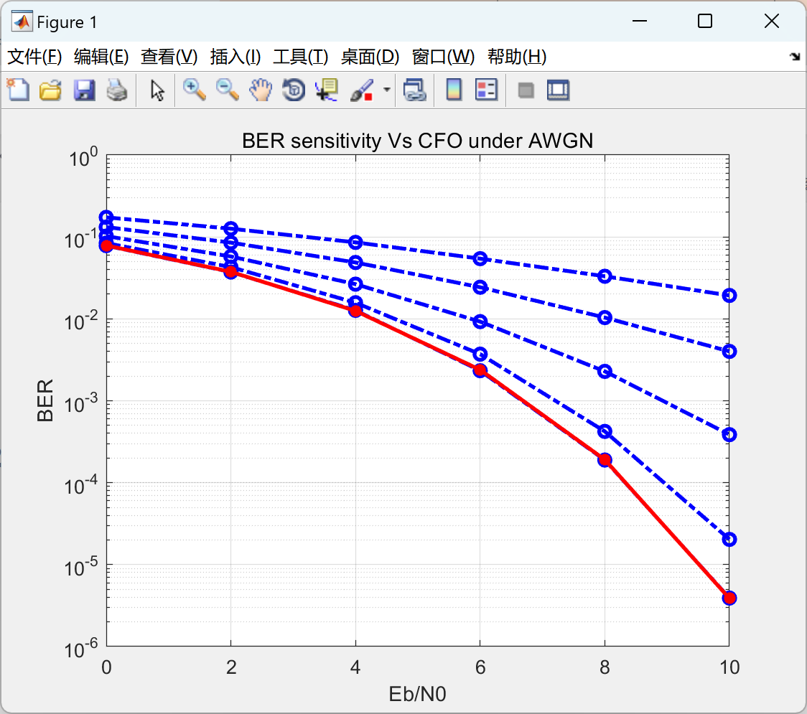

# Sensitivity of OFDM System to Different Carrier Frequency Offset (CFO) in AWGN Channels: A Study on Bit Error Rate (BER) Sensitivity with Matlab Code Implementation

[Sensitivity]Study on BER Sensitivity of OFDM System under Different Carrier Frequency Offset (CFO) in AWGN Channel (Matlab Code Implementation)

## Images

<!-- PAYMENT_BLOCK -->

## Get this dataset

- Payment link (Stripe): [Buy now](https://buy.stripe.com/3cs8yP7sY87d0vu9AB)
- Payment QR code: 

<!-- /PAYMENT_BLOCK -->
